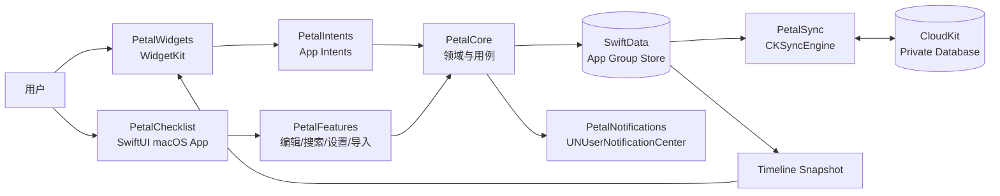

# 花瓣清单：桌面小组件 — 技术架构

**状态：** 已批准的 MVP 架构  
**日期：** 2026-09-23  
**对应规格：** [`docs/product/petal-checklist-widget-prd.md`](../product/petal-checklist-widget-prd.md)

## 1. 架构目标

该架构必须同时满足四个约束：

1. Widget 是主要交互面，但 Widget Extension 不是持续运行的普通 App。
2. 所有编辑离线可用，且 App 与 Widget 必须读取同一份本地数据。
3. 多设备同步不能以牺牲本地可靠性或制造整卡覆盖为代价。
4. 后续 iPhone/iPad 客户端必须能够复用领域模型、同步协议和 Widget 代码。

因此系统采用“本地 SwiftData 为真相来源、CloudKit 作为异步复制层”的离线优先架构。App 与 Widget Extension 通过 App Group 共享本地数据库；`CKSyncEngine` 负责私人 CloudKit 数据库的增量同步。不开启 iCloud 时，只停止复制层，不更换本地数据模型。

## 2. 系统视图



关键规则：

- Widget 只从本地共享存储读取，不等待网络。
- App Intent 必须先完成本地事务，再返回并触发 Widget timeline reload。
- CloudKit 同步失败不得回滚已成功的本地编辑。
- 通知调度依据本地数据重建；CloudKit 不被当作闹钟执行器。

## 3. 仓库布局

保留现有 Windows WPF 版本不动，在仓库新增 `apple/`：

```text
apple/
├── PetalChecklist.xcodeproj
├── Config/
│   ├── Shared.xcconfig
│   ├── Debug.xcconfig
│   └── Release.xcconfig
├── PetalChecklist/
│   ├── App/
│   ├── Navigation/
│   ├── CardLibrary/
│   ├── CardEditor/
│   ├── QuickCapture/
│   ├── Settings/
│   ├── Onboarding/
│   ├── Resources/
│   └── PetalChecklist.entitlements
├── PetalWidgets/
│   ├── PetalWidgetBundle.swift
│   ├── ChecklistWidget.swift
│   ├── ChecklistWidgetView.swift
│   ├── ChecklistTimelineProvider.swift
│   ├── ChecklistWidgetConfiguration.swift
│   └── PetalWidgets.entitlements
├── Packages/
│   └── PetalKit/
│       ├── Package.swift
│       ├── Sources/
│       │   ├── PetalCore/
│       │   ├── PetalPersistence/
│       │   ├── PetalSync/
│       │   ├── PetalNotifications/
│       │   ├── PetalImportExport/
│       │   └── PetalDesignSystem/
│       └── Tests/
├── PetalChecklistTests/
├── PetalChecklistUITests/
└── scripts/
    ├── test.sh
    ├── verify-localization.sh
    └── verify-release.sh
```

`PetalKit` 是一个本地 Swift Package，其中每个 library target 只承担一个责任：

- **PetalCore：** 纯领域类型、业务规则和用例协议，不依赖 UI、CloudKit 或通知框架。
- **PetalPersistence：** SwiftData Schema、迁移、App Group 容器、Repository 实现。
- **PetalSync：** CloudKit record 映射、outbox、增量同步、冲突副本和同步状态。
- **PetalNotifications：** 提醒计算、权限和 `UNUserNotificationCenter` 适配。
- **PetalImportExport：** Windows JSON 导入、Petal JSON 备份和 Markdown 导出。
- **PetalDesignSystem：** 主题 token、字体策略、Widget 与 App 共用组件。

禁止在 Feature View 中直接访问 SwiftData、CloudKit 或 `UNUserNotificationCenter`。

## 4. Target 与标识

### 4.1 Targets

| Target | 类型 | 最低版本 | 依赖 |
| --- | --- | --- | --- |
| `PetalChecklist` | macOS App | macOS 14 | 全部本地 Packages |
| `PetalWidgets` | Widget Extension | macOS 14 | Core、Persistence、DesignSystem |
| `PetalChecklistTests` | Unit/Integration Tests | macOS 14 | 全部非 UI Packages |
| `PetalChecklistUITests` | UI Tests | macOS 14 | App |

### 4.2 标识候选

开发阶段通过 `.xcconfig` 集中配置：

```text
PRODUCT_BUNDLE_IDENTIFIER = com.petalchecklist.mac
WIDGET_BUNDLE_IDENTIFIER = com.petalchecklist.mac.widgets
APP_GROUP_IDENTIFIER = group.com.petalchecklist.shared
ICLOUD_CONTAINER_IDENTIFIER = iCloud.com.petalchecklist
```

加入 Apple Developer Program 后立即在开发者后台尝试注册这一组标识。若已被占用，只允许在首次 TestFlight 构建前集中更换 `.xcconfig`、entitlements 和 CloudKit container；第一个分发构建之后不得再次改变 Bundle ID。

### 4.3 Entitlements

App 与 Widget Extension 均启用：

- App Sandbox。
- App Groups。
- iCloud / CloudKit（加入付费计划后）。

App 额外启用用户选择文件的读写权限，用于导入导出。网络访问只用于 Apple CloudKit；不允许任意第三方网络服务。

## 5. 领域模型

所有跨进程和跨设备实体使用稳定 UUID。时间统一存储为 UTC `Date`；每日提醒另外保存本地分钟数和最后计算时区。

### 5.1 核心类型

```swift
public struct CardID: Hashable, Codable, Sendable {
    public let rawValue: UUID
}

public struct LineID: Hashable, Codable, Sendable {
    public let rawValue: UUID
}

public enum CardStatus: String, Codable, Sendable {
    case active
    case archived
    case trashed
}

public enum LineKind: String, Codable, Sendable {
    case text
    case todo
}

public enum ThemeID: String, Codable, CaseIterable, Sendable {
    case cream
    case mint
    case sakura
    case sky
    case paper
}

public enum WidgetDisplaySize: Sendable {
    case medium
    case large
}

public enum ReminderRule: Codable, Sendable, Equatable {
    case oneTime(Date)
    case daily(localMinute: Int, timeZoneIdentifier: String)
}
```

Repository command/query values `CardScope`, `NewLineDraft`, `LineMutation`,
`SearchResult`, `MoveDirection`, and `WidgetDisplaySize` also belong to
`PetalCore`; neither UI nor persistence defines competing copies.

### 5.2 Card

```swift
public struct Card: Identifiable, Codable, Sendable, Equatable {
    public let id: CardID
    public var title: String
    public var status: CardStatus
    public var themeID: ThemeID
    public var isInbox: Bool
    public var createdAt: Date
    public var modifiedAt: Date
    public var archivedAt: Date?
    public var deletedAt: Date?
    public var revision: Int64
    public var deviceID: String
}
```

### 5.3 CardLine

```swift
public struct CardLine: Identifiable, Codable, Sendable, Equatable {
    public let id: LineID
    public let cardID: CardID
    public var kind: LineKind
    public var text: String
    public var sortIndex: Int64
    public var isCompleted: Bool
    public var completedAt: Date?
    public var lastDailyCompletionKey: String?
    public var dailyStreak: Int
    public var reminder: Reminder?
    public var createdAt: Date
    public var modifiedAt: Date
    public var deletedAt: Date?
    public var revision: Int64
    public var deviceID: String
}
```

`lastDailyCompletionKey` 使用用户当前日历和时区计算的 `yyyy-MM-dd` 字符串，只用于判断某个当地日是否已完成；不能替代 UTC 审计时间。

### 5.4 Reminder

```swift
public struct Reminder: Codable, Sendable, Equatable {
    public var rule: ReminderRule
    public var isEnabled: Bool
    public var snoozedUntil: Date?
    public var lastDeliveredAt: Date?
}
```

### 5.5 冲突与同步

```swift
public struct ConflictArtifact: Identifiable, Codable, Sendable {
    public let id: UUID
    public let cardID: CardID
    public let lineID: LineID?
    public let losingPayload: Data
    public let capturedAt: Date
    public let expiresAt: Date
    public var hasBeenPresented: Bool
}

public enum SyncState: Sendable, Equatable {
    case synced(Date)
    case syncing
    case offline
    case failed(SyncFailure)
}
```

## 6. 本地持久化

### 6.1 SwiftData Store

`PetalPersistence` 在 App Group container 中创建唯一 SwiftData SQLite store：

```text
<App Group>/Library/Application Support/Petal/Petal.sqlite
```

App、Widget timeline provider 和 App Intent 均使用相同的 `ModelContainerFactory`。所有写入通过 `PetalRepository` actor 串行执行：

```swift
public actor PetalRepository {
    public func card(id: CardID) async throws -> Card?
    public func cards(scope: CardScope) async throws -> [Card]
    public func lines(cardID: CardID) async throws -> [CardLine]
    public func addLine(_ draft: NewLineDraft, now: Date) async throws -> CardLine
    public func updateLine(_ mutation: LineMutation, now: Date) async throws -> CardLine
    public func setCompleted(lineID: LineID, completed: Bool, now: Date) async throws
    public func reorder(cardID: CardID, orderedLineIDs: [LineID], now: Date) async throws
    public func moveCard(_ cardID: CardID, to status: CardStatus, replacementInbox: CardID?, now: Date) async throws
    public func purgeExpiredTrash(now: Date) async throws
    public func deleteAllData(resetGeneration: UUID, now: Date) async throws
}
```

每个事务同时写入业务实体和 `OutboxChange`，从而保证本地修改与待同步记录不会分离。

### 6.2 Schema 迁移

Schema 使用显式版本枚举：

```swift
enum PetalSchemaV1: VersionedSchema { /* Card, CardLine, OutboxChange... */ }
enum PetalMigrationPlan: SchemaMigrationPlan { /* only explicit stages */ }
```

未知新版本不得被旧代码覆盖。导入和升级前均创建可恢复 JSON 快照。

### 6.3 收集箱不变量

- 任意时刻必须恰好存在一个 `isInbox == true` 的活跃卡片。
- 删除或归档收集箱前，Repository 要求传入新的默认卡片。
- 删除全部数据完成后创建一张空收集箱，但不得恢复示例内容。

## 7. CloudKit 同步

### 7.1 为什么不使用整库自动镜像

产品要求用户能关闭同步、保留完整本地副本，并对不同内容行进行合并。因此采用显式 `CKSyncEngine` 映射，不把 CloudKit 当成本地数据库的唯一宿主。

### 7.2 Record 设计

私人 CloudKit Database 使用以下 record types：

- `PTCard`：一张卡片一个 record。
- `PTLine`：一行一个 record，通过 `cardID` 关联。
- `PTUserState`：默认卡片、reset generation 和同步协议版本。
- `PTTombstone`：删除传播和 30 天保留。

主题配置保存在 `PTCard`。Widget 布局和所选卡片不上传。

### 7.3 Outbox 与同步顺序

1. Repository 本地事务更新实体并追加 `OutboxChange`。
2. `CloudSyncCoordinator` 向 `CKSyncEngine` 提交变更。
3. 成功后删除对应 outbox 条目并更新 server change token。
4. 网络错误保留 outbox，使用指数退避，不阻塞本地 UI。
5. App 启动、回到前台、用户下拉刷新、Widget intent 完成和系统推送时触发同步请求。

### 7.4 冲突规则

- 不同 `PTLine` record 的编辑天然合并。
- 同一 record 的 server conflict 比较 `modifiedAt`；相同时间使用 `deviceID` 字典序稳定决胜。
- 文本、类型、完成状态或提醒存在差异时，将失败方编码为 `ConflictArtifact`。
- 冲突副本 30 天后清理；首次出现时只提示一次。
- 整卡删除使用 tombstone；未过期 tombstone 优先于来自离线设备的旧编辑。

### 7.5 关闭同步

- 关闭后停止 CKSyncEngine 拉取与推送，但保留本地数据库和 outbox。
- 再次开启时先获取远端变更，再上传本地 outbox，并应用相同冲突规则。
- 用户选择“删除全部数据”时写入新的 reset generation，清除本地业务实体和远端 records；其他设备观察到新 generation 后清除旧数据并创建空收集箱。

## 8. Widget 架构

### 8.1 配置

`ChecklistWidgetConfigurationIntent` 提供：

```swift
@Parameter(title: "Card") var card: CardEntity
@Parameter(title: "Theme") var theme: ThemeOption
@Parameter(title: "Typeface") var typeface: TypefaceOption
@Parameter(title: "Material") var material: MaterialOption
```

`CardEntityQuery` 只返回活跃卡片。配置本身由系统保存，视为设备本地数据。

### 8.2 Timeline

`ChecklistTimelineProvider` 把 WidgetKit 的 family 映射为 PetalCore 的
`WidgetDisplaySize`，再从共享 store 构建不可变 `WidgetSnapshot`：

```swift
public struct WidgetSnapshot: Sendable, Equatable {
    public let cardID: CardID
    public let title: String
    public let visibleLines: [WidgetLine]
    public let hiddenCount: Int
    public let cardState: WidgetCardState
    public let syncBadge: WidgetSyncBadge?
    public let nextRefresh: Date
}
```

Timeline 至少安排下一次本地午夜刷新，使“完成项次日隐藏”和每日待办恢复不依赖 App 正在运行。普通网络同步刷新由系统预算决定，不能承诺实时轮询。

### 8.3 交互

- `ToggleTodoIntent`：本地事务更新完成状态，重排，重建通知，调用 `WidgetCenter.reloadTimelines(ofKind:)` 后返回。
- `OpenCardIntent`：通过 URL `petal://card/<uuid>` 打开编辑器。
- `QuickAddIntent`：打开绑定卡片的快速新增 panel，不尝试在 Widget 内输入。
- Widget 中禁止 `TextField`、`TextEditor` 和依赖滚动手势的布局。

## 9. App UI 架构

采用 SwiftUI feature modules 与 Observation：

- `AppRouter` 处理 sidebar selection、卡片深链和设置页。
- `CardLibraryModel` 负责查询范围、搜索和列表状态。
- `CardEditorModel` 负责行级编辑、转换、排序和提醒表单。
- `QuickCaptureModel` 负责目标卡片、草稿和提交生命周期。
- `SettingsModel` 负责主题默认值、快捷键、通知声音、同步开关和数据操作。

View 只发送用户意图，不包含持久化规则。

### 9.1 全局快捷键

使用 macOS Carbon `RegisterEventHotKey` 封装 `GlobalHotKeyClient`，不引入第三方依赖。默认 `⌥⌘N`，设置变更时先注销旧组合，再注册新组合；注册失败返回可展示的冲突错误。

### 9.2 快速新增 Panel

使用可复用 `NSPanel` 承载 SwiftUI `QuickCaptureView`：

- 从 Widget 打开时预选 card ID。
- 从全局快捷键打开时使用收集箱。
- `Enter` 提交、`Shift + Enter` 换行、`Esc` 取消。
- 成功后关闭并恢复之前的前台 App；失败时保留草稿。

## 10. 提醒架构

`ReminderScheduler` 只消费领域值，不直接读取 UI：

```swift
public protocol ReminderScheduling: Sendable {
    func requestAuthorization() async throws -> AuthorizationState
    func reconcile(lines: [CardLine], now: Date, calendar: Calendar) async throws
    func cancel(lineID: LineID) async
    func cancelAll() async
}
```

- 单次提醒使用绝对 `Date`。
- 每日提醒使用当前 Calendar/TimeZone 计算下一次日期。
- 通知 identifier 固定为 `line.<uuid>`，确保跨编辑可替换、完成后可取消。
- Snooze 使用 `line.<uuid>.snooze`，只允许一个待处理延后通知。
- 通知 action identifiers 固定为 `complete`、`snooze-5m`、`open-card`。
- 声音默认 `nil`；用户开启后使用系统默认声音。
- App 启动、时区变化、系统日期变化、同步入站和 line mutation 后执行 reconcile。

## 11. 导入与导出

### 11.1 Windows 导入

`WindowsNotesImporter` 将 SchemaVersion 1 JSON 转换为领域 drafts：

- 每个 Windows Note -> Card。
- 标题 -> Card title。
- 正文按段落 -> text lines。
- Todo -> todo lines，保留完成状态。
- Note reminder -> 在存在待办时绑定首个未完成待办；不存在待办时创建同名待办并绑定提醒。
- 五套主题一对一映射。
- 忽略窗口几何、置顶、隐藏、折叠和 Pomodoro。

导入文件 SHA-256 与源 Note ID 组成 `ImportFingerprint`，用于阻止重复导入。导入前生成当前 Petal JSON 快照。

### 11.2 Petal JSON

JSON 包含 schema version、cards、lines、reminders、themes 和 sync-independent settings；不包含 Widget 配置、设备 ID、change token 或通知 identifiers。

### 11.3 Markdown

每张卡片导出一个文件：标题为一级标题，普通文字保持段落，待办使用 `- [ ]` / `- [x]`，提醒以可读注释附在对应行下方。

## 12. Design System 与本地化

`ThemeID` 在 `PetalCore` 中固定为：

```swift
public enum ThemeID: String, Codable, CaseIterable, Sendable {
    case cream
    case mint
    case sakura
    case sky
    case paper
}
```

每套主题提供 light、dark 和 widget vibrant token。字体只使用 `Font.system` 的 default、rounded 和 serif designs，并针对中文回退验证。

所有用户可见字符串使用 String Catalog：

- `Localizable.xcstrings`：App。
- `Widgets.xcstrings`：Widget 和配置。
- `InfoPlist.xcstrings`：名称与权限说明。

中文和英文缺失任何 key 时，release verification 必须失败。

## 13. 无障碍

- 所有 icon-only 按钮必须提供可本地化 accessibility label。
- Widget Toggle 必须合并朗读待办文字、完成状态和“切换完成状态”动作。
- 拖动排序必须同时提供键盘“上移/下移”命令。
- 主题 token 必须通过浅色、深色、vibrant 三种模式的对比度测试。
- 动画通过 `accessibilityReduceMotion` 降级为无位移或短淡入淡出。
- UI tests 必须覆盖无鼠标创建卡片、新增待办、搜索、归档和恢复。

## 14. 错误与恢复策略

| 场景 | 用户体验 | 数据处理 |
| --- | --- | --- |
| 本地写入失败 | 保留草稿并显示可重试错误 | 不关闭编辑器，不写 outbox |
| iCloud 离线 | 显示“离线” | 本地提交并累计 outbox |
| CloudKit 限流 | 非阻塞提示 | 尊重 retry-after，指数退避 |
| Widget 读库失败 | 显示缓存与轻量警告 | 下一 timeline 重试 |
| 卡片已归档/删除 | 显示状态与重新选择入口 | 不自动改绑 Widget |
| 提醒权限拒绝 | 提示不会通知并链接系统设置 | 保留 reminder model |
| 导入文件损坏 | 展示精确失败原因 | 原数据库保持不变 |
| 未知 Schema | 阻止写入 | 提示升级 App，不覆盖文件 |

## 15. 测试架构

### 15.1 单元测试

使用 Swift Testing，覆盖：

- 完成项当天展示、次日隐藏。
- 每日待办跨午夜恢复与跨时区计算。
- 收集箱唯一性。
- 排序和类型转换。
- 回收站与冲突副本 30 天清理。
- 冲突决胜与 tombstone 优先级。
- Windows JSON 映射、指纹去重和损坏文件。
- JSON/Markdown round trip。

### 15.2 集成测试

- 临时 SwiftData store 的事务与迁移。
- App Group store 被 App 和模拟 Widget client 共同读取。
- fake CloudKit transport 的 outbox、重试、入站合并和 reset generation。
- fake notification center 的 schedule/reconcile/cancel。

### 15.3 UI 测试

- Onboarding 与示例卡片。
- 主窗口三栏导航。
- 快速新增键盘流程。
- 搜索、归档、回收站恢复。
- 设置提醒和权限拒绝状态。
- VoiceOver identifiers 与全键盘主流程。

### 15.4 手工矩阵

系统桌面 Widget 的添加和布局不能完全依赖 App UI tests，因此发布候选版必须在以下环境完成可复核清单：

- Apple Silicon + macOS 14、当前 macOS。
- Intel + macOS 14 或其可运行的最新版本。
- 中文、英文。
- 浅色、深色、系统 Widget 特殊渲染。
- 两台真实设备的 iCloud 冲突与通知取消。

## 16. 可观测性

不接第三方遥测。诊断仅包括：

- 本地环形日志，最多保留 7 天，默认不包含卡片文字。
- App 内“导出诊断”由用户主动触发，导出版本、系统、错误码和同步状态。
- Apple 提供的崩溃诊断与 App Store 汇总指标。
- 反馈邮件不自动附加诊断或内容，用户必须主动选择附件。

## 17. 发布架构门槛

1. 本地阶段：Personal Team，App Group、本地 SwiftData、Widget、App Intent 和编辑器。
2. 核心原型通过：加入 Apple Developer Program，注册生产 identifiers。
3. 同步阶段：启用 CloudKit development environment，完成双机测试。
4. Beta 阶段：迁移 CloudKit schema 到 production，外部 TestFlight 20–30 人。
5. 正式阶段：隐私政策、支持页、双语元数据、截图、审核说明和签名验证全部通过。

## 18. 架构决策记录

### ADR-001：不移植 WPF UI

WPF、WinForms tray 和 Win32 窗口行为无法提交为原生 Apple Widget 产品。保留 Windows 源码作为业务行为参考，Apple 端原生重写。

### ADR-002：Widget-first，不提供便签窗口

桌面呈现只使用 Widget。承载 App 是编辑和管理工具，不模拟 Windows 置顶窗口。

### ADR-003：本地 SwiftData + 显式 CloudKit 复制

避免把网络可用性带入交互路径，同时支持关闭同步、行级冲突和可恢复 outbox。

### ADR-004：无第三方运行时依赖

MVP 使用 Apple SDK 完成 UI、持久化、同步、通知、快捷键和诊断，减少隐私披露与供应链风险。

### ADR-005：内容行是最小同步与冲突单位

避免两台设备编辑不同待办时整张卡片互相覆盖，为未来 iPhone/iPad 复用稳定协议。
